# AC-Corporate Network Troubleshooting Lab

**Hands-on Windows Server, Active Directory, DNS, DHCP, TCP/IP, SMB and Windows Firewall troubleshooting portfolio project**

## Project Overview

This project documents the configuration, investigation and troubleshooting of a small corporate-style Windows network built in **Oracle VirtualBox**. It uses a Windows Server 2025 domain controller and a domain-joined Windows 11 workstation to reproduce common IT Help Desk and network support incidents.

The project emphasizes a practical troubleshooting workflow: **identify the symptom, gather evidence, test a hypothesis, make a controlled change, verify the result and document the outcome.**

> **Environment:** An isolated educational lab, not a production company network. All names and addresses below are lab examples.

## Lab Environment

| Component | Configuration |
|---|---|
| Hypervisor | Oracle VirtualBox |
| Virtual network | Internal Network (`AC-LAB`) |
| Domain | `corp.aclab.test` |
| Domain controller | `AC-LAB-DC01` — Windows Server 2025 |
| Domain controller IP | `192.168.50.10/24` (static) |
| Workstation | `AC-LAB-PC01` — Windows 11 Enterprise |
| Workstation IP | `192.168.50.100/24` (DHCP, at final verification) |
| DHCP scope | `192.168.50.100`–`192.168.50.150` |
| DNS server | `192.168.50.10` |
| Server roles/services | Active Directory Domain Services, DNS, DHCP, SMB file sharing |
| Tools | Windows PowerShell, `ping`, `nslookup`, `Resolve-DnsName`, `Test-NetConnection` |

### Network Architecture

```text
                Oracle VirtualBox
            Internal Network: AC-LAB
                   192.168.50.0/24

  +-----------------------------------------------+
  | AC-LAB-DC01                                   |
  | Windows Server 2025                           |
  | 192.168.50.10 (static)                        |
  |                                               |
  | Active Directory | DNS | DHCP | SMB Shares    |
  +-----------------------+-----------------------+
                          |
                          | Private virtual network
                          |
  +-----------------------+-----------------------+
  | AC-LAB-PC01                                   |
  | Windows 11 Enterprise                         |
  | 192.168.50.100 (DHCP lease at final check)    |
  | Domain-joined workstation                     |
  +-----------------------------------------------+
```

There is **no default gateway** in this lab because the two virtual machines communicate over an isolated internal network without a router.

## Troubleshooting Incidents

### Incident 1 — Intermittent DNS Query Timeouts

**Symptom:** `nslookup` intermittently reported DNS request timeouts while attempting to resolve the domain controller, but eventually returned the correct IP address. `Resolve-DnsName` also succeeded.

**Investigation:** Compared results from `nslookup` and `Resolve-DnsName`, explicitly queried DNS server `192.168.50.10` and checked successful A-record resolution.

**Outcome:** DNS resolution to `192.168.50.10` was verified, but the exact cause of intermittent `nslookup` timeouts was **not conclusively identified**. This is documented as an investigation rather than a confirmed permanent fix.

[Read Incident 1 investigation](Troubleshooting/DNS_Investigation.md)

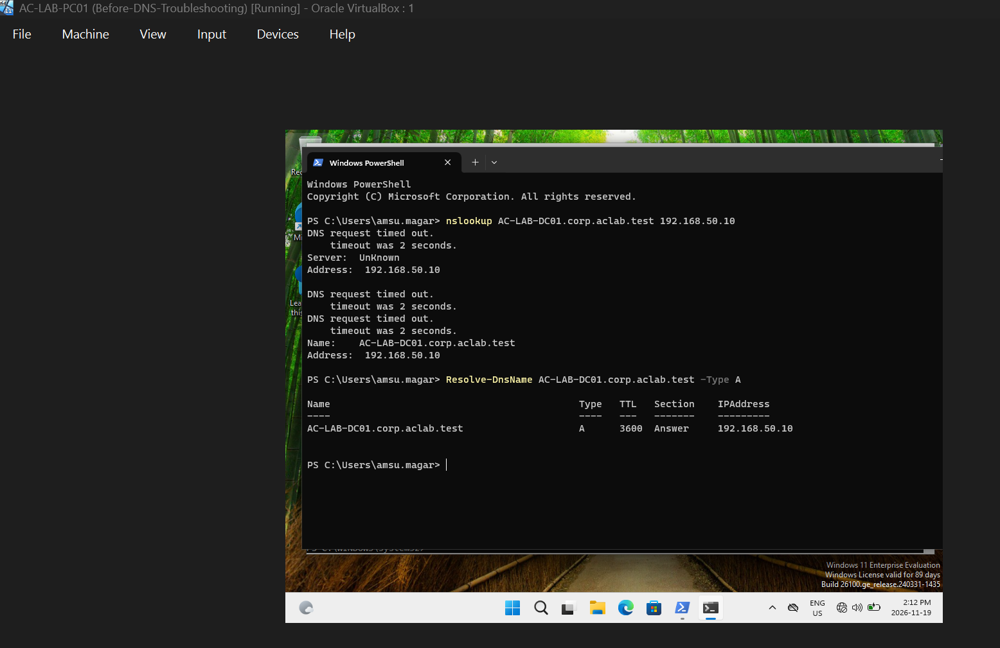

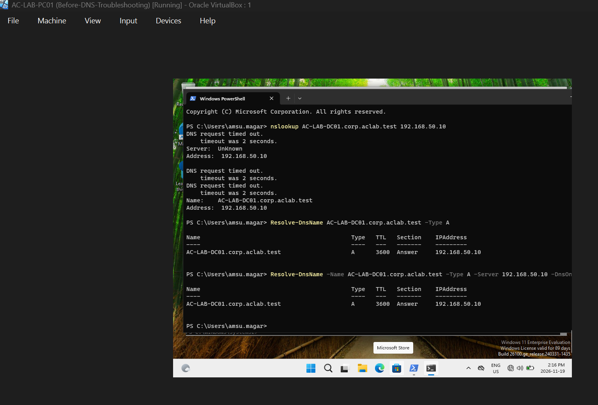

### Incident 2 — Incorrect DNS Server Configuration

**Symptom:** A workstation cannot resolve internal domain names when its DNS requests are sent to an incorrect server address.

**Investigation:** In the original controlled exercise, temporarily changed and then restored the workstation DNS configuration. Later reproduced the failure without altering the working DHCP settings by explicitly querying `192.168.50.99` using `nslookup`.

**Resolution and verification:** The incorrect DNS server timed out. A direct query to the correct DNS server, `192.168.50.10`, successfully resolved `AC-LAB-DC01.corp.aclab.test`. The workstation's configured DNS server was verified as `192.168.50.10`.

[Read Incident 2 investigation](Troubleshooting/DNS_Misconfiguration_Incident.md)

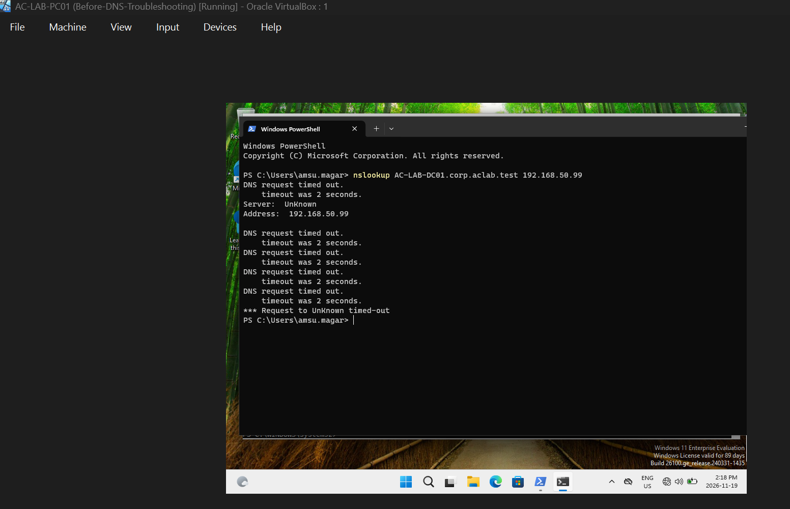

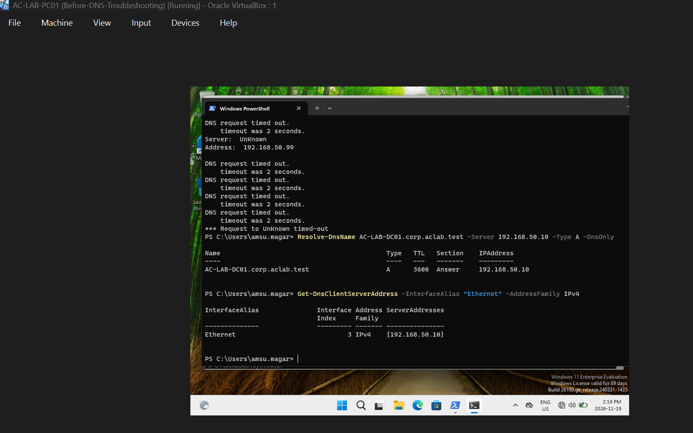

### Incident 3 — Incorrect IPv4 Subnet Configuration

**Symptom:** A workstation configured with an address on the wrong subnet cannot reach its domain controller.

**Investigation:** Changed the workstation from the original `192.168.50.20/24` configuration to `192.168.60.20/24` and observed failed connectivity to server `192.168.50.10`.

**Resolution and verification:** Restored the correct `192.168.50.20/24` address during the exercise and verified successful ping replies to the domain controller. The workstation was subsequently moved to DHCP for Incident 5.

[Read Incident 3 investigation](Troubleshooting/IP_Configuration_Incident.md)

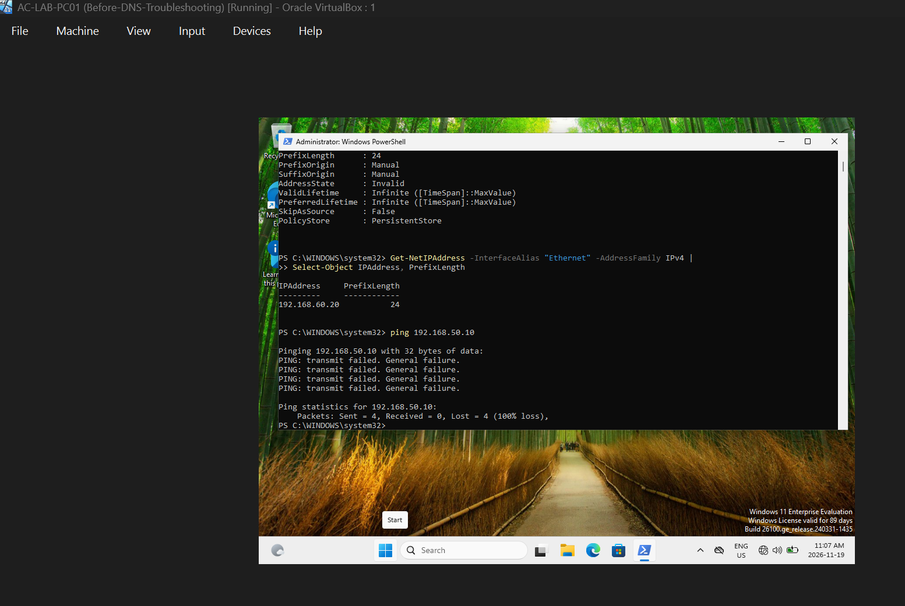

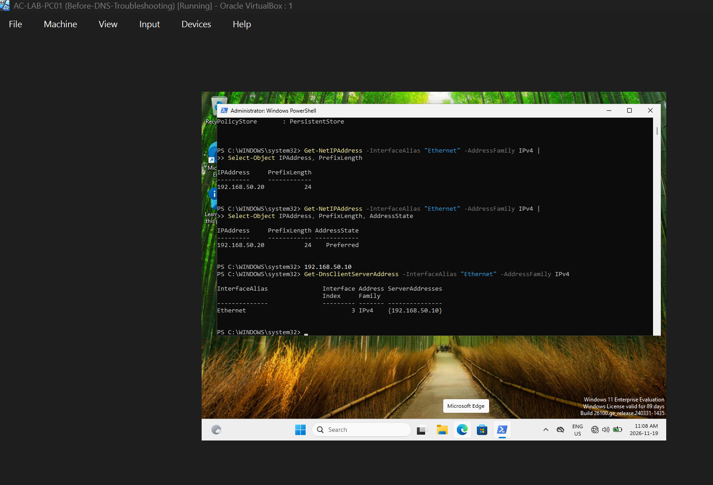

### Incident 4 — SMB Shared Folder Access and Permissions

**Symptom:** Employee access to network shares depends on both share permissions and NTFS permissions.

**Investigation:** Reviewed SMB shares and permission assignments. Tested an authorized employee account's ability to write to the `IT-Shared` share and a separately created `Restricted-Test` share configured for read-only employee access.

**Outcome:** Authorized access to the IT share succeeded, while a write attempt to the restricted share was denied as expected. This demonstrated group-based access control and least-privilege permissions.

[Read Incident 4 investigation](Troubleshooting/Shared_Folder_Access_Incident.md)

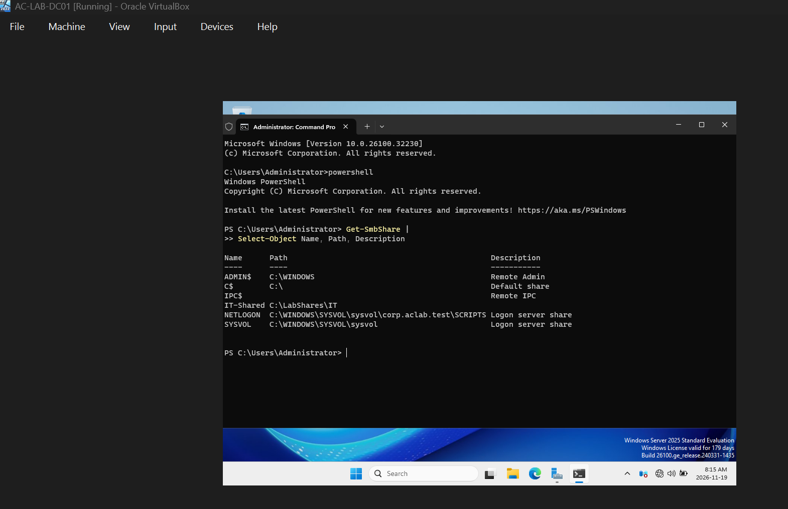

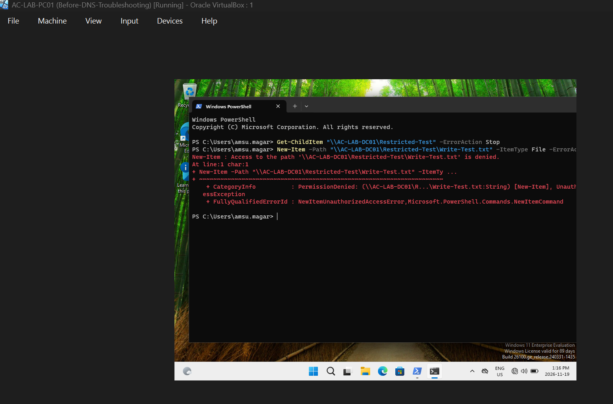

### Incident 5 — DHCP Address Assignment and APIPA

**Symptom:** After switching the workstation from a static IP address to DHCP, the first automatic configuration attempt produced an APIPA address (`169.254.221.56`) rather than an address from the intended scope.

**Investigation and configuration:**

- Installed the Windows Server DHCP role.
- Authorized the DHCP server in Active Directory.
- Created and activated scope `AC-LAB-Office` for `192.168.50.100`–`192.168.50.150`.
- Configured DHCP DNS option `192.168.50.10` and domain `corp.aclab.test`.
- Renewed the workstation lease with `ipconfig /renew`.

**Outcome:** The workstation received `192.168.50.100/24` from DHCP server `192.168.50.10`. Subsequent connectivity and DNS checks passed. The exact reason for the first unsuccessful lease attempt was not conclusively identified.

[Read Incident 5 investigation](Troubleshooting/DHCP_Investigation.md)

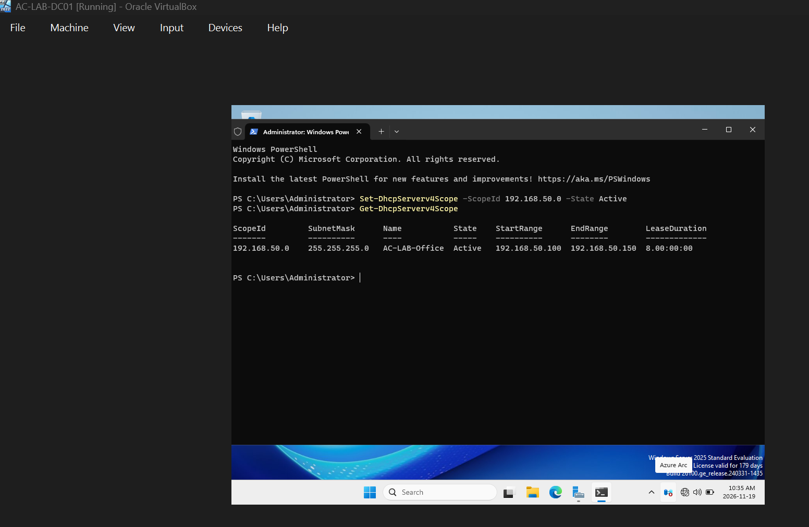

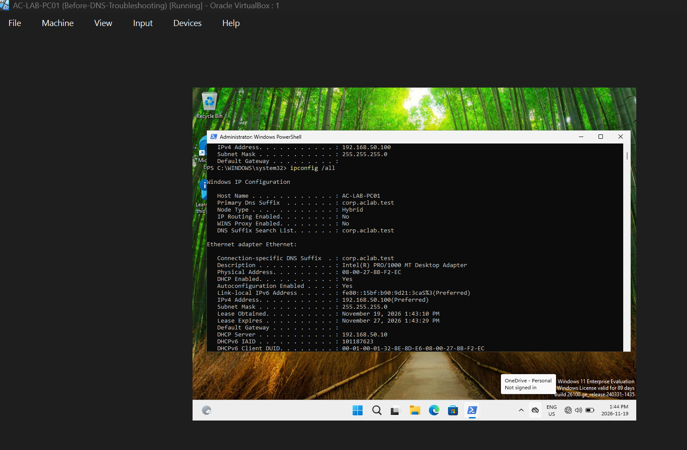

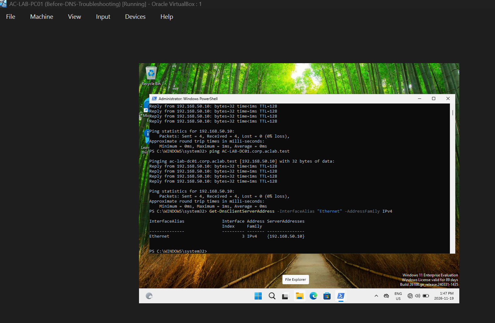

### Incident 6 — Windows Firewall Blocking ICMP

**Symptom:** The domain controller could not ping the Windows 11 workstation (`192.168.50.100`): **4 packets sent, 0 received, 100% packet loss**.

**Investigation:** Verified that Windows Firewall was enabled and the client network was `DomainAuthenticated`. Inspected disabled inbound ICMP Echo Request allow rules.

**Resolution:** Created a custom **Domain-profile, inbound ICMPv4 Echo Request** firewall rule that permits requests only from domain controller `192.168.50.10`. Did **not** disable Windows Firewall.

**Verification:** Repeated the ping from the domain controller and received **4 of 4 replies (0% packet loss)**. Confirmed the rule's source restriction and that Domain Firewall remained enabled.

[Read Incident 6 investigation](Troubleshooting/Firewall_Investigation.md)

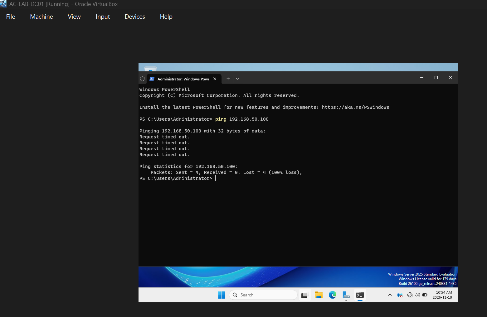

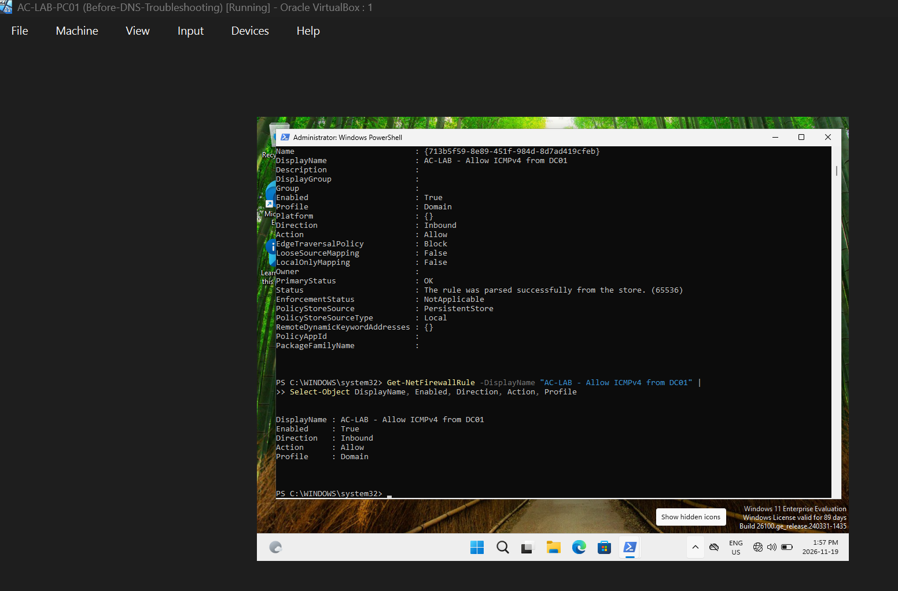

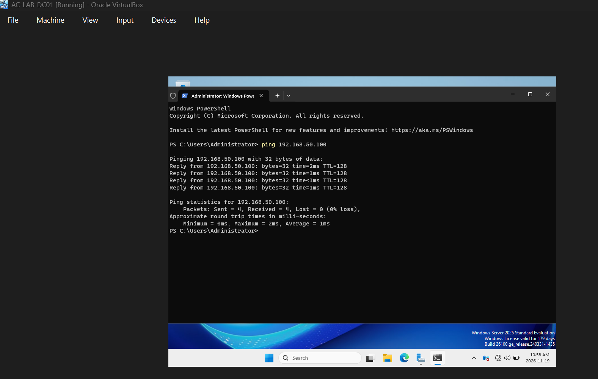

## Final Network Health Check

After completing the troubleshooting scenarios, the Windows 11 workstation passed these checks:

| Test | Verified result |
|---|---|
| Workstation IPv4 | `192.168.50.100` |
| DNS server | `192.168.50.10` |
| Domain controller A-record lookup | `192.168.50.10` |
| Ping PC01 to DC01 | 4 replies, 0% loss |
| SMB connectivity to DC01 | TCP port `445` reachable (`TcpTestSucceeded : True`) |
| Ping DC01 to PC01 after firewall fix | 4 replies, 0% loss |

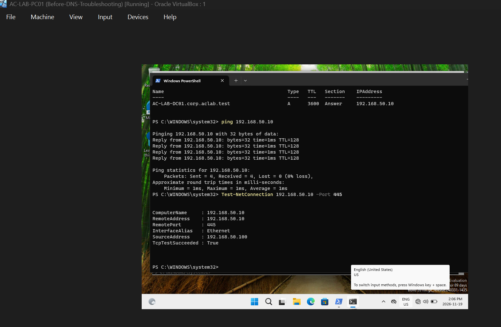

## Skills Demonstrated

- Windows Server 2025 administration and domain networking
- Active Directory-integrated DNS and DHCP configuration
- IPv4 addressing, subnet troubleshooting and APIPA diagnostics
- DNS lookup investigation with `nslookup` and `Resolve-DnsName`
- Windows PowerShell network administration
- SMB shares, NTFS permissions and security groups
- Windows Defender Firewall and scoped inbound rules
- Network connectivity validation with ICMP and TCP port checks
- Structured troubleshooting documentation and screenshot evidence

## Project Files

```text
AC_NetworkLab/
├── README.md
├── Troubleshooting/
│   ├── DNS_Investigation.md
│   ├── DNS_Misconfiguration_Incident.md
│   ├── IP_Configuration_Incident.md
│   ├── Shared_Folder_Access_Incident.md
│   ├── DHCP_Investigation.md
│   └── Firewall_Investigation.md
└── screenshots/
    ├── incident-01-dns-intermittent-timeouts.png
    ├── incident-01-dns-resolution-verified.png
    ├── incident-02-dns-failure.png
    ├── incident-02-dns-verified.png
    ├── incident-03-ip-failure.png
    ├── incident-03-ip-restored.png
    ├── incident-04-read-only-enforced.png
    ├── incident-05-dhcp-client-lease.png
    ├── incident-06-icmp-blocked-baseline.png
    ├── incident-06-icmp-connectivity-restored.png
    └── final-network-health-check.png
```

*The tree above shows key screenshots only; the `screenshots` folder also contains additional configuration and troubleshooting evidence.*

## Project Status

**Lab exercises and final connectivity tests completed.** Incident 1's intermittent `nslookup` timeout behavior remains documented as an unresolved diagnostic finding.

## Purpose

Built as an independently documented, hands-on portfolio project to demonstrate relevant skills for **IT Help Desk Technician, Service Desk Analyst and Junior IT Support** roles.
