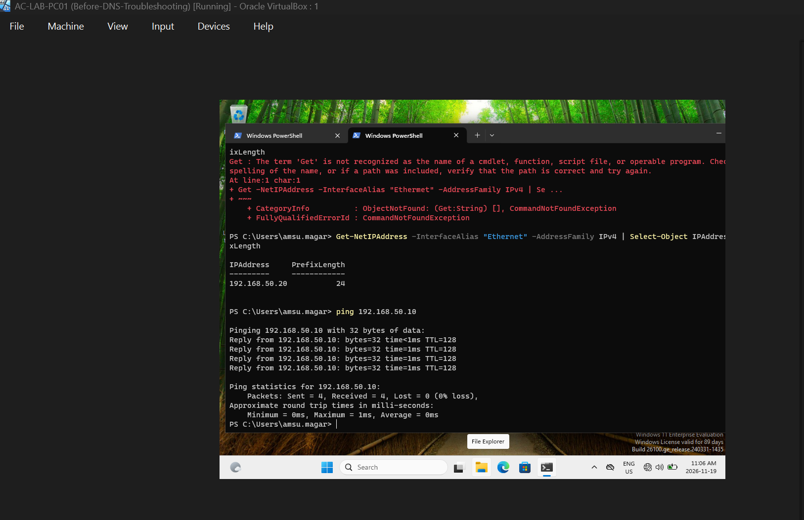
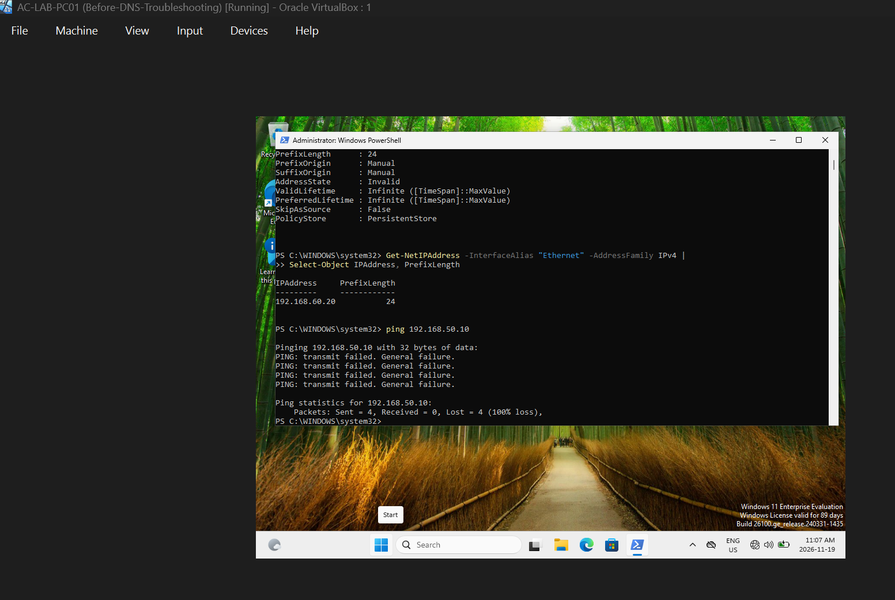
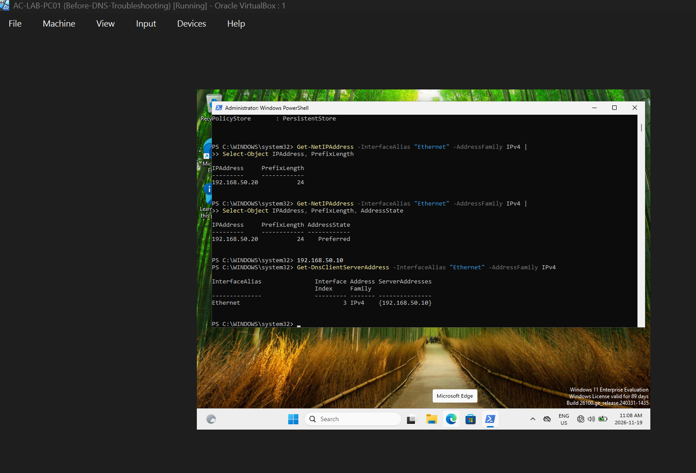

# Incident 3 — Incorrect IPv4 Configuration Troubleshooting

## 1. Environment

| Component | Configuration |
|---|---|
| Server | AC-LAB-DC01 |
| Server OS | Windows Server 2025 |
| Client | AC-LAB-PC01 |
| Client OS | Windows 11 Enterprise |
| Active Directory Domain | corp.aclab.test |
| Server IP | 192.168.50.10/24 |
| Original Client IP | 192.168.50.20/24 |
| Incorrect Client IP | 192.168.60.20/24 |
| Network | VirtualBox Internal Network (AC-LAB) |

## 2. Reported Problem

A domain-joined Windows 11 workstation was unable to communicate with its domain controller because of an incorrect IPv4 configuration.

The scenario was intentionally reproduced in an isolated lab to investigate how an incorrect subnet affects network connectivity.

## 3. Initial Network Configuration

The domain controller was configured with:

- IP address: 192.168.50.10
- Subnet mask: 255.255.255.0
- DNS server: 192.168.50.10

The workstation originally used:

- IP address: 192.168.50.20
- Subnet mask: 255.255.255.0
- DNS server: 192.168.50.10

Both computers were on the 192.168.50.0/24 network.

### Baseline Evidence

## 4. Simulating the Incident

The workstation's IP address was temporarily changed from:

192.168.50.20/24

to:

192.168.60.20/24

The domain controller remained on 192.168.50.10/24.

Because the computers were now on different IPv4 subnets and the isolated network had no router or default gateway, normal communication between them failed.

## 5. Troubleshooting Investigation

The workstation's IPv4 configuration was inspected using PowerShell.

The following command was used to test connectivity:

    ping 192.168.50.10

### Observed Results

- The workstation could not communicate with the domain controller.
- Ping requests failed.
- Packet loss was 100%.
- The test demonstrated an incorrect IP subnet configuration.

### Failure Evidence

## 6. Root Cause

The workstation was assigned an IP address on the incorrect subnet.

Incorrect workstation subnet:

    192.168.60.0/24

Correct server subnet:

    192.168.50.0/24

The environment had no router to provide communication between the two networks.

This prevented the workstation from reaching the domain controller.

## 7. Resolution

The workstation's IPv4 settings were restored to the correct configuration:

- IP address: 192.168.50.20
- Prefix length: 24
- DNS server: 192.168.50.10

The IP address state was verified as Preferred.

## 8. Verification After Resolution

The following connectivity tests were performed:

    ping 192.168.50.10

    ping AC-LAB-DC01.corp.aclab.test

### Verified Results

| Test | Result |
|---|---|
| Correct IPv4 subnet | Restored |
| IP address state | Preferred |
| Ping domain controller IP | Successful |
| Ping domain controller hostname | Successful |
| Packet loss after correction | 0% |

The workstation successfully communicated with the domain controller after its IPv4 address was restored.

### Resolution Evidence

## 9. Important Note

This scenario used static IPv4 addressing during the investigation.

In a later DHCP exercise, the workstation was configured to obtain an address automatically and successfully received 192.168.50.100.

## 10. Skills Demonstrated

- IPv4 addressing and subnetting
- Windows 11 network configuration
- PowerShell troubleshooting
- ICMP connectivity testing
- Incorrect subnet diagnosis
- DNS and domain controller connectivity verification
- Incident documentation
- Network problem resolution

## 11. Final Status

**Resolved — The workstation's correct IPv4 configuration was restored, and connectivity to the domain controller was successfully verified.**

This exercise demonstrated how incorrect IP addressing can interrupt communication on a corporate network.
